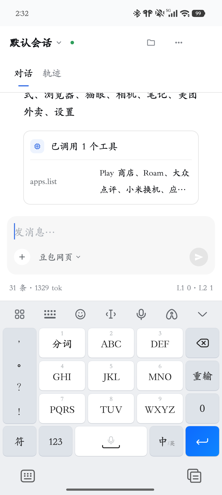
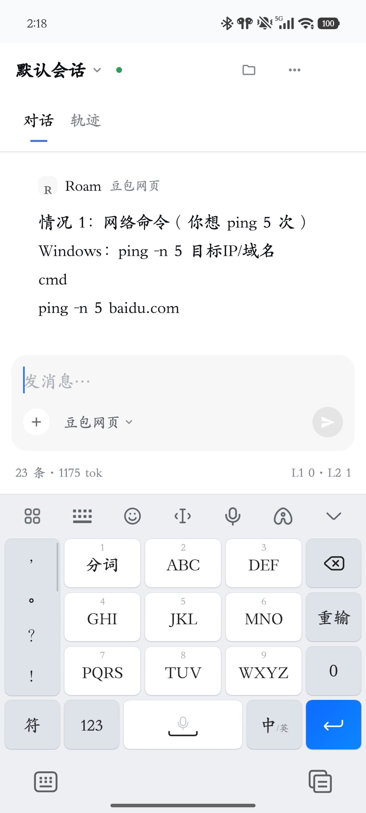
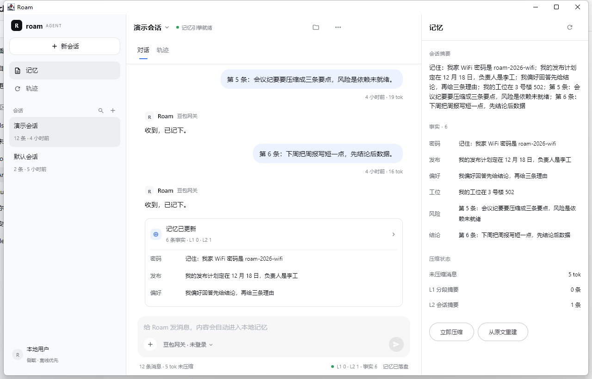
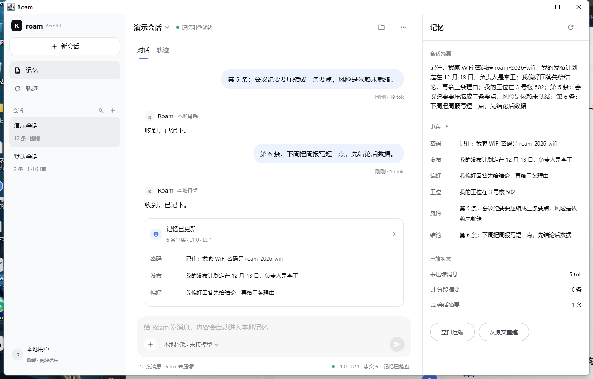
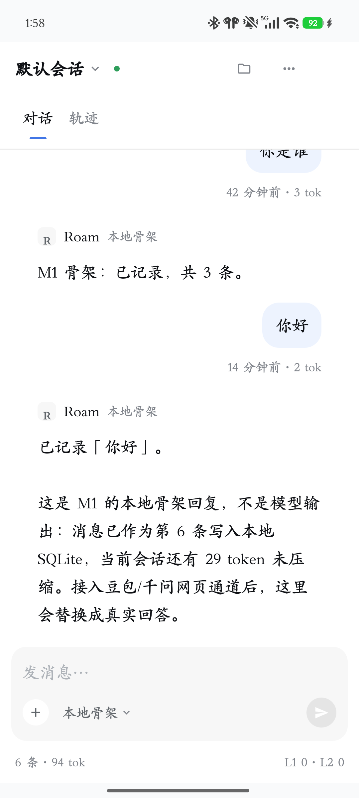

# Roam

**Compose Multiplatform 全栈 Agent**：Android 与桌面共用一套 UI/业务，用免费问答助手（豆包/千问等网页登录态）作答，
记忆全部落本地 SQLite，手机能力以本地工具暴露。

核心取舍：不花订阅费、不用按 token 计费的模型 API；代价是免费通道无 SLA、会触发风控与站点改版，
所以整个方案围绕「**可路由、可降级、可审计**」设计。

## 技术栈

| 层 | 选型 |
|---|---|
| UI / 业务 | Compose Multiplatform 1.9.3（Android + Desktop，共享 `commonMain`） |
| 语言 / 构建 | Kotlin 2.2.21 · AGP 8.13.2 · Gradle 8.14 · JDK 21 |
| 本地记忆 | SQLDelight 2.4.1（Android `AndroidSqliteDriver` / 桌面 `JdbcSqliteDriver`） |
| 免费通道 | WebViewDriver（手机）· GatewayDriver（桌面连 FreeBridge）· FreeApiDriver（官方免费额度） |
| 对外工具协议 | 进程内 `ToolRegistry` 为核心；MCP 作为可选适配器（Kotlin SDK 0.9.0） |

## 目录

```
composeApp/   CMP 应用：commonMain / androidMain / desktopMain
bridge/       FreeBridge（Node/TS）：Playwright 持久登录态、OpenAI 兼容接口、MCP 代理（可选）
docs/         技术方案、可行性报告、ADR
spikes/       M0 可行性实验（网页探测、工具协议、MCP、记忆成本、CMP 冒烟）
scripts/      便携工具链（JDK/Node/Gradle 一键就绪）
```

## 当前状态

- [x] 技术方案 v1.1（CMP）：[docs/technical-design.md](docs/technical-design.md)
- [x] M0 首轮验证：[docs/feasibility-report.md](docs/feasibility-report.md)
- [x] MCP 适配器可行性（E3 通过）
- [x] 记忆成本结构（E4：分层为全量的 9.9%）
- [x] CMP 跨端冒烟（E7：9.82MB APK + 桌面窗口）
- [ ] M0 收尾：登录态实测 30 条 + 真机端到端 20 条
- [x] M1-1 CMP 工程骨架 + SQLDelight 记忆引擎 + 7 个单测
- [x] M1-2 UI 高仿 DeepSeek Harness（三栏 / 记忆面板 / 流式模拟）
- [x] M1-3 豆包网页通道：真实登录态 → 注入提问 → 流式抓取 → 落库
- [x] M1-4 只读工具 + 工具循环（剪贴板 / 应用 / 日历 / 通知）
- [ ] M2 通义/千问通道、Router 熔断、FreeBridge、MCP 适配器

### 工具调用（M1-4）



- `ToolRegistry` + `AgentProtocol`（文本 JSON 协议，带修复与降级）+ `IntentRouter` 本地意图兜底。
- 四个只读工具：`clipboard.read`、`apps.list`、`calendar.events`、`notifications.list`。
- 循环：意图/模型给出 tool → 执行 → 结果回喂豆包 → 输出 `final`；最多 3 步，结果以工具卡片展示。
- 真机验证：`apps.list`（截图）与 `calendar.events`（“未来 1 天没有日历事件”）均闭环。
- 权限：日历在启动时请求 READ_CALENDAR；通知需在系统设置里开启「通知使用权」。
- 现实约束：豆包并不总是遵守 JSON 协议，因此常见只读意图先本地命中工具，再让它组织自然语言回答。

### 真实通道（M1-3）



- `DoubaoWebDriver`：应用内常驻一个 WebView 打开豆包，复用登录 Cookie；
  注入脚本写入输入框、点发送，轮询 `.message-list` 文本并去噪（时间行、搜索状态行、提问回显），
  以「完整快照」回调给 UI 流式展示。
- 失败路径明确：未登录 → 本地骨架 + 提示登录；验证码 → 报「需要手动验证」；超时 120s → 报错回退。
- 已知限制：豆包改版会破坏选择器；虚拟列表/折叠卡片可能只抓到部分正文；暂未做 Markdown 渲染。

### 桌面端（FreeBridge，M2 进行中）

桌面没有 WebView，通过本机网关驱动浏览器里的豆包：

```powershell
cd bridge
npm install --registry=https://registry.npmmirror.com
node login.mjs        # 首次登录；执行前先停掉 server
node server.mjs       # 保持运行

# 另开终端
.\gradlew.bat :composeApp:run
```



- chip 三态：`豆包网关 · 未启动` / `豆包网关 · 未登录` / `豆包网关`（就绪）。
- 网关每 8 秒刷新 `/health`，登录后无需重启 App。
- 桌面工具：`clipboard.read`；手机专属工具（应用/日历/通知）不注册。
- 详见 [bridge/README.md](bridge/README.md)。

> 注意：桌面端能启动、能连上网关并正确显示状态；真正问答需要你在 `bridge/.profile` 里登录一次豆包。
> 我这边验证到「未登录」状态与错误回退，登录后的抓取沿用手机端同一套选择器，尚未在桌面 profile 里实测。

### UI（按 DSH 高仿）



三栏布局、配色（`#f9fafb` 侧栏 / `#edf3fe` 用户气泡 / `#4176e6` 发送键）、
对话/轨迹 tabs、工具卡片、底部状态行都对齐 DSH；规格与差异见 [docs/ui-spec.md](docs/ui-spec.md)。

### 移动端（真机 1080×2400）



- 记忆面板默认关闭，窄屏点右上角文件夹从右侧滑入（300dp）；系统栏 insets 与输入法已处理；
  底部状态行在窄屏收敛为两项，不再折行。
- **模型与登录**：输入区的模型 chip 打开登录面板，内置 WebView 打开豆包/千问网页登录，
  Cookie 持久化在本机（[截图](docs/evidence/phone-login.png)）。
- **应用图标**：深色圆角 `R` 自适应图标，脚本 `scripts/make-icons.ps1`。

### M1 已落地（记忆链路）

- `composeApp`：`commonMain` 放记忆引擎与 UI，`androidMain` / `desktopMain` 各自提供 SQLDelight 驱动。
- 表结构：`session / message / summary / fact / tool_audit`，原文 append-only。
- `MemoryEngine`：分段（L1）→ 合并（L2）→ 事实（L3）、上下文装配、可从 L0 重建、导出 Markdown。
- 测试：`gradle :composeApp:desktopTest` → **7/7 通过**（序列、阈值触发、合并取代、重建幂等、预算约束、事实保留、导出）。

## 快速开始

本机没有系统级 JDK/Node/Gradle，全部使用 `.tools/` 便携版：

```powershell
.\scripts\setup-toolchain.ps1     # 幂等：缺什么装什么，并生成 .tools\env.ps1
. .\.tools\env.ps1               # 当前会话生效（JAVA_HOME / PATH / ANDROID_HOME）
```

实验与复现方式见 [spikes/README.md](spikes/README.md)。

## 构建与常见问题

统一用仓库自带的 Gradle wrapper（8.14.3，`gradle-wrapper.properties` 指向腾讯镜像）：

```powershell
.\gradlew.bat :composeApp:desktopTest     # 记忆引擎单测（7 个）
.\gradlew.bat :composeApp:assembleDebug   # Android APK
.\gradlew.bat :composeApp:run             # 桌面窗口
```

> 不要用系统里其它版本的 Gradle（尤其 Gradle 9）：AGP 8.13 只在 8.13–8.14 上验证过。

**Android Studio 报 `Could not resolve org.jetbrains:annotations:{strictly 13.0}`**

这是 Gradle Kotlin DSL 把 `org.jetbrains:annotations` 钉在 embedded-Kotlin 的 13.0，
而 AGP 8.13 的传递依赖要求 23.0.0，导致插件 classpath 解析失败。本项目做了两层处理：

1. **仓库自带 wrapper**：Studio 里 `Settings → Build, Execution, Deployment → Build Tools → Gradle`，
   把 "Use Gradle from" 设为 `gradle-wrapper.properties file`，然后重新 Sync；
2. **根 `build.gradle.kts` 兜底**：对所有子工程的 buildscript classpath 强制
   `org.jetbrains:annotations:23.0.0`（向下兼容）。

Sync 前建议先 `.\gradlew.bat --stop`，并在报错信息里确认 Gradle 版本是 **8.14.3**。
若仍失败，把 `gradle-wrapper.properties` 的 `distributionUrl` 换回官方源再试。
