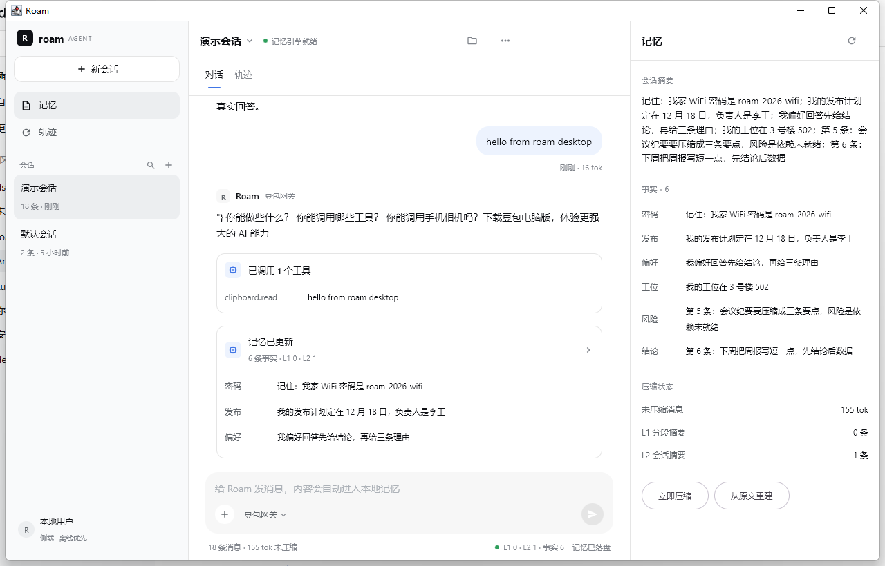

# Roam

English | [简体中文](README.zh-CN.md)

> A local-first, **zero model cost** AI agent for Android and desktop.
> It answers through a free web assistant you already log into (Doubao / Qwen), keeps every memory in local SQLite,
> and exposes phone capabilities as tools — all in one Compose Multiplatform codebase.

[](https://kotlinlang.org)
[](https://www.jetbrains.com/compose-multiplatform/)
[](#)

---

## Why Roam

- **No subscription, no per-token billing.** The model is a web assistant session you already have; the app never calls a paid API.
- **Memory that belongs to you.** Raw messages are append-only in SQLite; summaries are derived and can be rebuilt at any time.
- **One codebase, two platforms.** Compose Multiplatform shares `commonMain` between the Android app and the desktop app.
- **Phone capabilities as tools.** Clipboard, apps, calendar and notifications are exposed to the agent with explicit permissions.
- **Built to degrade.** Every free channel can break (risk control, site redesign). Failures fall back to a local stub, never to a frozen session.

## Architecture

```
Android (Compose)  ─┐
                    ├─ commonMain: AgentRuntime · MemoryEngine · ToolRegistry · UI
Desktop (Compose)  ─┘        │
                             ├─ WebViewDriver (Android): in-app WebView → doubao.com
                             ├─ GatewayDriver (Desktop): HTTP → FreeBridge (Playwright)
                             └─ SQLite via SQLDelight (AndroidSqliteDriver / JdbcSqliteDriver)

FreeBridge (Node) ── Playwright + persistent profile ── doubao.com
```

Memory is layered: **L0** raw messages → **L1** segment summaries → **L2** rolling session summary → **L3** extracted facts.
The context builder budgets and prioritises these layers instead of replaying the whole conversation every turn.

## Screenshots

| Mobile | Desktop |
|---|---|
|  |  |

The UI deliberately mirrors DeepSeek Harness: three-pane layout, `#f9fafb` sidebar, `#edf3fe` user bubble,
`#4176e6` send button. See [docs/ui-spec.md](docs/ui-spec.md) for the full spec and known differences.

## Quick start

### Prerequisites

| Tool | Version | Notes |
|---|---|---|
| JDK | 21 | portable build is installed by the setup script |
| Android SDK | platform 36 | only needed for the Android target |
| Node.js | 22 | only needed for the desktop bridge |
| Microsoft Edge | recent | used by Playwright for the desktop channel |

### 1. Toolchain (Windows, one-off)

```powershell
.\scripts\setup-toolchain.ps1 -Persist
# reopen the terminal afterwards; JAVA_HOME / PATH will point at .tools
```

The script installs portable JDK 21, Node 22 and Gradle into `.tools/` (git-ignored) and can write the user environment variables.

### 2. Android

```powershell
.\gradlew.bat :composeApp:assembleDebug
adb install -r composeApp\build\outputs\apk\debug\composeApp-debug.apk
```

Open **Roam → model chip → 登录**, log in to Doubao once, then chat. The login cookie stays on the device.

### 3. Desktop

```powershell
.\gradlew.bat :composeApp:run
```

Click the model chip → **登录**. Roam starts FreeBridge in visible mode and opens a browser window;
log in there once and the chip switches to `豆包网关`.

Manual alternative:

```powershell
cd bridge
npm install --registry=https://registry.npmmirror.com
node server.mjs
```

See [bridge/README.md](bridge/README.md) for endpoints and troubleshooting.

## Project layout

```
composeApp/          Compose Multiplatform app (commonMain / androidMain / desktopMain)
  ├─ core/memory     layered memory engine, SQLDelight schema
  ├─ core/tool       tool registry, text tool protocol, local intent router
  ├─ core/assistant  AssistantDriver abstraction
  ├─ ui              DSH-style UI, store, memory panel
  └─ androidMain     WebView driver, phone tools, notification listener
bridge/              FreeBridge: Playwright gateway for the desktop channel
docs/                design, feasibility report, UI spec, ADRs, evidence
spikes/              M0 experiments (web probe, protocol, MCP, memory, CMP)
scripts/             portable toolchain and icon generator
```

## Documentation

| Document | Contents |
|---|---|
| [docs/technical-design.md](docs/technical-design.md) | architecture, data model, memory algorithm, roadmap |
| [docs/feasibility-report.md](docs/feasibility-report.md) | measured M0 experiments and go/no-go |
| [docs/ui-spec.md](docs/ui-spec.md) | DSH-style UI spec and mobile adaptation |
| [docs/adr/](docs/adr) | key decisions (layered memory, free-channel drivers, CMP) |
| [spikes/README.md](spikes/README.md) | how to reproduce every experiment |

## Testing

```powershell
.\gradlew.bat :composeApp:desktopTest    # 18 unit tests
.\gradlew.bat :composeApp:lintDebug      # Android lint (0 errors)
```

Covered: memory seq/compaction/rebuild/export, tool protocol parsing, local intent routing.

## Known limitations

- **Web automation is fragile.** Selectors break when Doubao ships a redesign; answers may include UI leftovers.
- **No Markdown rendering yet.** Code blocks and lists are shown as plain text.
- **One Doubao conversation per app launch.** Session binding is on the roadmap.
- **Calendar / notifications need permissions.** Calendar asks at startup; notifications require “notification access” in system settings.
- **Desktop needs a browser session.** The bridge profile (`bridge/.profile`) must be logged in once.

## Roadmap

- [x] M0 feasibility: web channel, tool protocol, MCP SDK, memory cost, CMP spike
- [x] M1: CMP shell, SQLDelight memory, Doubao WebView channel, read-only tools
- [ ] M2: Qwen/Tongyi channels, router with circuit breaker, MCP adapter
- [ ] M3: session binding, Markdown rendering, desktop packaging

## Security & privacy

- Everything is local-first: memory lives in a SQLite file on your device.
- Login cookies stay in the app's WebView / `bridge/.profile`; both are git-ignored.
- No paid API keys are used, and no telemetry is sent.
- Tool calls are audited; sensitive clipboard/notification content is a deliberate design surface — review before enabling.

## Disclaimer

Roam is a personal, self-hosted project. Driving a website's UI with automation may violate that site's terms of service;
use it only with your own account and at your own risk. The project is not affiliated with ByteDance, Alibaba, DeepSeek or JetBrains.

## License

Not chosen yet. Add the license you want (MIT / Apache-2.0 are common for this kind of project) before distributing.
