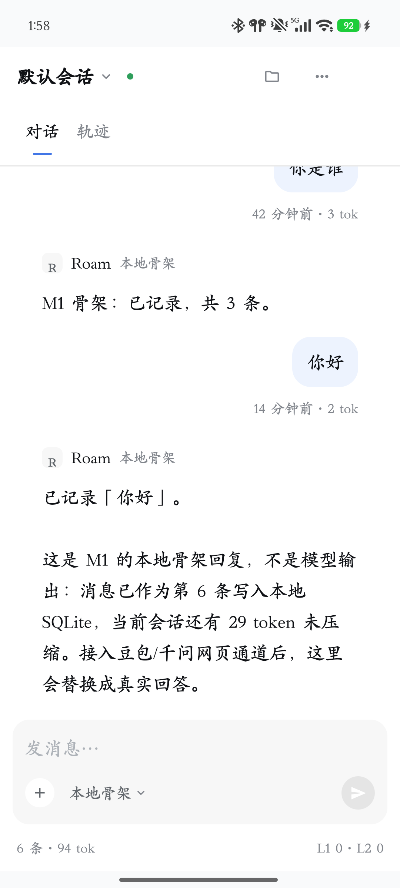
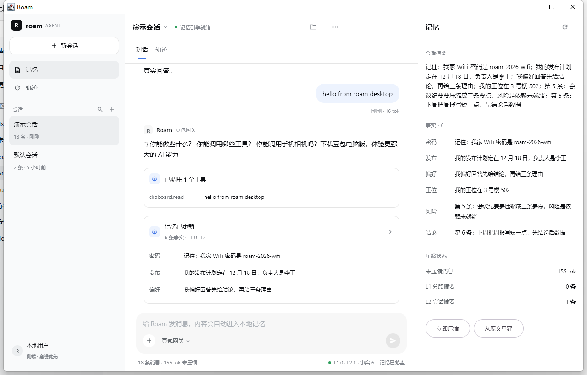

# Roam

[English](README.md) | 简体中文

> 一个本地优先、**零模型费用**的 Android + 桌面 Agent。
> 用你已经登录的免费网页助手（豆包 / 千问）作答，记忆全部落本地 SQLite，手机能力以工具形式交给模型，
> 全部代码共享同一套 Compose Multiplatform。

[](https://github.com/xiaoshaguabuzai/roam/actions/workflows/ci.yml)
[](https://kotlinlang.org)
[](https://www.jetbrains.com/compose-multiplatform/)
[](#)

---

## 为什么是 Roam

- **不订阅、不按 token 计费。** 用的是你本来就登录着的网页会话，不会调用任何付费 API。
- **记忆属于你。** 原始消息 append-only 存在 SQLite，摘要只是派生数据，随时可以从原文重建。
- **一套代码，两端运行。** Compose Multiplatform 让 Android 与桌面共享 `commonMain`。
- **手机能力变成工具。** 剪贴板、应用、日历、通知，在明确授权后交给 Agent 调用。
- **为「坏掉」而设计。** 免费通道随时可能被风控或改版打断；失败一律降级到本地骨架，绝不让会话卡死。

## 架构

```
Android（Compose） ─┐
                    ├─ commonMain：AgentRuntime · MemoryEngine · ToolRegistry · UI
桌面（Compose）    ─┘        │
                             ├─ WebViewDriver（Android）：应用内 WebView → doubao.com
                             ├─ GatewayDriver（桌面）：HTTP → FreeBridge（Playwright）
                             └─ SQLite（SQLDelight：AndroidSqliteDriver / JdbcSqliteDriver）

FreeBridge（Node） ── Playwright + 持久登录 profile ── doubao.com
```

记忆分四层：**L0** 原始消息 → **L1** 分段摘要 → **L2** 会话滚动摘要 → **L3** 抽取事实。
上下文装配按预算裁剪这四层，而不是每轮重放全部会话。

## 界面

| 手机 | 桌面 |
|---|---|
|  |  |

UI 按 DeepSeek Harness 高仿：三栏布局、`#f9fafb` 侧栏、`#edf3fe` 用户气泡、`#4176e6` 发送键。
完整规格与差异见 [docs/ui-spec.md](docs/ui-spec.md)。

## 快速开始

### 环境要求

| 工具 | 版本 | 说明 |
|---|---|---|
| JDK | 21 | 安装脚本会装便携版 |
| Android SDK | platform 36 | 仅 Android 目标需要 |
| Node.js | 22 | 仅桌面网关需要 |
| Microsoft Edge | 较新版本 | 桌面通道用 Playwright 驱动它 |

### 1. 工具链（Windows，一次即可）

```powershell
.\scripts\setup-toolchain.ps1 -Persist
# 之后重开终端，JAVA_HOME / PATH 会指向 .tools
```

脚本会把便携版 JDK 21、Node 22、Gradle 装进 `.tools/`（已 gitignore），并可写入用户环境变量。

### 2. Android

```powershell
.\gradlew.bat :composeApp:assembleDebug
adb install -r composeApp\build\outputs\apk\debug\composeApp-debug.apk
```

打开 **Roam → 模型 chip → 登录**，扫码登录一次豆包，然后就能对话。Cookie 留在本机。

### 3. 桌面

```powershell
.\gradlew.bat :composeApp:run
```

点模型 chip → **登录**：Roam 会以可见模式拉起 FreeBridge 并打开浏览器，登录一次后 chip 变成「豆包网关」。

也可以手动启动网关：

```powershell
cd bridge
npm install --registry=https://registry.npmmirror.com
node server.mjs
```

接口与排查见 [bridge/README.md](bridge/README.md)。

## 目录结构

```
composeApp/          Compose Multiplatform 应用（commonMain / androidMain / desktopMain）
  ├─ core/memory     分层记忆引擎、SQLDelight schema
  ├─ core/tool       工具注册表、文本工具协议、本地意图路由
  ├─ core/assistant  AssistantDriver 抽象
  ├─ ui              DSH 风格 UI、Store、记忆面板
  └─ androidMain     WebView 驱动、手机工具、通知监听
bridge/              FreeBridge：桌面通道的 Playwright 网关
docs/                方案、可行性报告、UI 规格、ADR、证据截图
scripts/             便携工具链与图标生成
```

## 文档索引

| 文档 | 内容 |
|---|---|
| [docs/technical-design.md](docs/technical-design.md) | 架构、数据模型、记忆算法、里程碑 |
| [docs/feasibility-report.md](docs/feasibility-report.md) | M0 实测数据与 Go/No-Go |
| [docs/ui-spec.md](docs/ui-spec.md) | DSH 风格 UI 规格与移动端适配 |
| [docs/adr/](docs/adr) | 关键决策（分层记忆、免费通道驱动、CMP） |

## 测试

```powershell
.\gradlew.bat :composeApp:desktopTest    # 18 个单测
.\gradlew.bat :composeApp:lintDebug      # Android lint（0 errors）
```

覆盖：记忆序列/压缩/重建/导出、工具协议解析、本地意图路由。

GitHub Actions 在每次 push / PR 跑同一套测试，外加 Android lint 与 APK 构建（.github/workflows/ci.yml）；推送 * tag 会构建并发布 APK 与 Linux 桌面包（.github/workflows/release.yml）。

## 已知限制

- **网页自动化天然脆弱。** 豆包改版会破坏选择器，回答里偶尔夹带 UI 文案。
- **暂未做 Markdown 渲染。** 代码块、列表目前是纯文本。
- **一次启动对应一个豆包对话。** 会话绑定在路线图里。
- **日历/通知需要授权。** 日历启动时请求；通知需在系统设置里开启「通知使用权」。
- **桌面需要一次登录。** `bridge/.profile` 必须先登录过。

## 路线图

- [x] M0 可行性：网页通道、工具协议、MCP SDK、记忆成本、CMP 冒烟
- [x] M1：CMP 骨架、SQLDelight 记忆、豆包 WebView 通道、只读工具
- [ ] M2：通义/千问通道、带熔断的路由、MCP 适配器
- [ ] M3：会话绑定、Markdown 渲染、桌面打包

## 安全与隐私

- 本地优先：记忆就是一个设备上的 SQLite 文件。
- 登录态保存在应用 WebView 或 `bridge/.profile`，两者都已 gitignore。
- 不使用付费 API Key，不上报任何遥测。
- 工具调用有审计；剪贴板/通知属于敏感数据面，启用前请自行评估。

## 免责声明

Roam 是个人自托管项目。用自动化驱动网站 UI 可能违反站点服务条款，请只用自己的账号、自担风险。
本项目与字节跳动、阿里、DeepSeek、JetBrains 均无关联。

## 许可证

尚未选定。分发前请补上你需要的许可证（MIT / Apache-2.0 是这类项目的常见选择）。
